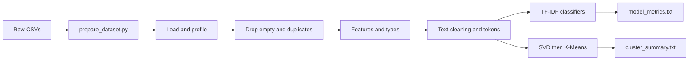

# YouTube Spam Collection — Analysis & Classification

**CSCI461 – Assignment #1**

Spam detection and unsupervised clustering on public YouTube comments from five popular music videos.

**Team**

1. Zeyad Ahmed
2. Mohamed Abdellatif
3. Steven Wilson
4. Abdalsalam Zaqzouq

---

## Overview

This project builds an end-to-end text analytics pipeline on the [YouTube Spam Collection](https://archive.ics.uci.edu/dataset/380/youtube+spam+collection):

1. Merge five labeled comment files into a single dataset with a `VIDEO` source column
2. Clean comments, engineer features, and compare spam vs. legitimate language
3. Train supervised TF-IDF classifiers to detect spam
4. Cluster comments with K-Means to uncover thematic structure

**Primary supervised result:** Logistic Regression with unigram TF-IDF reaches **94.6% accuracy** and **0.942 F1** on the spam class (stratified 80/20 test split). Five-fold cross-validation accuracy is **0.938 ± 0.016**.

**Clustering result:** K-Means with **k = 8** (silhouette **0.105**, adjusted Rand index **0.082**) groups comments more by theme and artist than by the spam label.

---

## Dataset

| Field        | Description                                                                          |
| ------------ | ------------------------------------------------------------------------------------ |
| `COMMENT_ID` | Unique comment identifier                                                            |
| `AUTHOR`     | Comment author display name                                                          |
| `DATE`       | Timestamp of the comment                                                             |
| `CONTENT`    | Raw comment text                                                                     |
| `CLASS`      | `1` = spam, `0` = not spam                                                           |
| `VIDEO`      | Source video (added by `prepare_dataset.py`): Psy, KatyPerry, LMFAO, Eminem, Shakira |

Raw CSVs live under `data/raw_data/`. Running `prepare_dataset.py` concatenates them and writes `data/dataset.csv` (1,953 rows before notebook cleaning; 1,753 after removing empty and duplicate comments).

**Citation:** Alberto, T. C., Lochter, J. V., & Almeida, T. A. (2015). _TubeSpam: Comment Spam Filtering on YouTube_. IEEE ICMLA. Dataset hosted on the [UCI Machine Learning Repository](https://archive.ics.uci.edu/dataset/380/youtube+spam+collection).

---

## Repository layout

```
Big_Data_assignment_1/
├── data/
│   ├── raw_data/              # Per-video YouTube Spam Collection CSVs
│   └── dataset.csv            # Merged dataset (+ VIDEO column)
├── notebook/
│   └── analysis.ipynb         # Full analysis: EDA, classification, clustering
├── output/
│   ├── cleaned_data.csv       # Cleaned features + cluster assignments
│   ├── model_metrics.txt      # Supervised metrics and interpretation
│   └── cluster_summary.txt    # K-Means silhouette, sizes, top terms
├── prepare_dataset.py         # Merge raw CSVs → dataset.csv
├── dockerfile                 # Jupyter SciPy image + NLTK
├── requirements.txt           # Extra pip deps (NLTK)
└── README.md
```

---

## Docker concepts (quick)

### Image vs container

| Term          | Meaning                                                                                                                                                                                                                   |
| ------------- | ------------------------------------------------------------------------------------------------------------------------------------------------------------------------------------------------------------------------- |
| **Image**     | A read-only blueprint (OS layers + Python + Jupyter + this project’s files and deps). Built once with `docker build` / pulled with `docker pull`. Tagging names a specific image, e.g. `zeyadahmed2005/bd-asign1:latest`. |
| **Container** | A running (or stopped) instance created from an image with `docker run`. You can start many containers from the same image; deleting a container does not delete the image.                                               |

Think of the image as a class and the container as an object: one image, many containers.

### Port mapping: `HOST_PORT:CONTAINER_PORT`

Jupyter inside the container listens on port **8888**. The flag `-p 8888:8888` means:

```text
-p HOST_PORT:CONTAINER_PORT
     │           │
     │           └── port inside the container (Jupyter)
     └── port on your machine (browser)
```

So `-p 8888:8888` maps `http://localhost:8888` on your PC to port 8888 in the container. To avoid a conflict with another local Jupyter, use a different host port, e.g. `-p 8889:8888`, then open `http://localhost:8889`.

---

## Prerequisites

1. [Docker Desktop](https://www.docker.com/products/docker-desktop/) installed and running
2. From a terminal, confirm the engine is up:

```bash
docker version
docker info
```

---

## Setup, build, run, and mount

All commands below assume your current directory is the project root (`Big_Data_assignment_1`).

### 1. (Optional) Rebuild the merged CSV on the host

```bash
python prepare_dataset.py
```

### 2. Build the custom image

```bash
docker build -f dockerfile -t youtube-spam:latest .
```

This uses `quay.io/jupyter/scipy-notebook:latest`, installs NLTK from `requirements.txt`, and copies `data/dataset.csv` plus `notebook/` into `/home/jovyan/work`.

### 3. Tag for Docker Hub

```bash
docker tag youtube-spam:latest zeyadahmed2005/bd-asign1:latest
```

(Or build and tag in one step:)

```bash
docker build -f dockerfile -t youtube-spam:latest -t zeyadahmed2005/bd-asign1:latest .
```

### 4. Run without a volume mount (uses files baked into the image)

```bash
docker run -p 8888:8888 --name youtube-spam-run zeyadahmed2005/bd-asign1:latest
```

- `-p 8888:8888` maps host ↔ container Jupyter port (see above)
- `--name youtube-spam-run` gives the container a stable name so you can stop/start it easily

Copy the token URL printed in the terminal (or open `http://localhost:8888` and paste the token). Open `notebook/analysis.ipynb` and **Run All** (`SEED = 42`).

**Note:** Without a volume mount, notebook outputs stay **inside this container**. That is fine if you keep the container (no `--rm`); use `docker start` to resume. To also keep copies on your Windows/Mac folders, use the mounts in step 5.

### 5. Run with volume mounts (persist notebook edits and outputs on the host)

**PowerShell (Windows):**

```powershell
docker run -p 8888:8888 --name youtube-spam-run `
  -v "${PWD}/data:/home/jovyan/work/data" `
  -v "${PWD}/notebook:/home/jovyan/work/notebook" `
  -v "${PWD}/output:/home/jovyan/work/output" `
  zeyadahmed2005/bd-asign1:latest
```

**bash / macOS / Linux / Git Bash:**

```bash
docker run -p 8888:8888 --name youtube-spam-run \
  -v "$(pwd)/data:/home/jovyan/work/data" \
  -v "$(pwd)/notebook:/home/jovyan/work/notebook" \
  -v "$(pwd)/output:/home/jovyan/work/output" \
  zeyadahmed2005/bd-asign1:latest
```

| Mount                                     | Purpose                                                |
| ----------------------------------------- | ------------------------------------------------------ |
| `data` → `/home/jovyan/work/data`         | Use / update host dataset from the container           |
| `notebook` → `/home/jovyan/work/notebook` | Edit the notebook on the host; changes persist         |
| `output` → `/home/jovyan/work/output`     | Write `cleaned_data.csv`, metrics, figures to the host |

### Stop and continue later (same container)

```bash
docker stop youtube-spam-run      # pause work; container is kept
docker start youtube-spam-run     # resume the same container anytime
docker start -a youtube-spam-run  # resume and attach logs (token/URL in the terminal)
```

If the name `youtube-spam-run` already exists from a previous `docker run`, do **not** run `docker run` again — use `docker start` instead. Only create a new container if you removed the old one.

### Useful container commands

```bash
docker ps                          # list running containers
docker ps -a                       # list all containers (including stopped)
docker logs youtube-spam-run       # Jupyter URL / token if you lost it
docker stop youtube-spam-run       # stop (keeps the container)
docker start youtube-spam-run      # start again later
docker rm youtube-spam-run         # delete the container only when you no longer need it
docker images                      # list local images
docker rmi youtube-spam:latest     # remove a local image tag (optional cleanup)
```

---

## Docker Hub

| Field              | Value                                             |
| ------------------ | ------------------------------------------------- |
| **Registry**       | [Docker Hub](https://hub.docker.com/)             |
| **Username**       | `zeyadahmed2005`                                  |
| **Repository**     | `bd-asign1`                                       |
| **Image**          | `zeyadahmed2005/bd-asign1`                        |
| **Tag**            | `latest`                                          |
| **Full reference** | `zeyadahmed2005/bd-asign1:latest`                 |
| **Hub page**       | https://hub.docker.com/r/zeyadahmed2005/bd-asign1 |

### Push (maintainers)

```bash
docker login
docker push zeyadahmed2005/bd-asign1:latest
```

### Pull and run (anyone reproducing from Docker Hub only)

Hub page: https://hub.docker.com/r/zeyadahmed2005/bd-asign1

```bash
docker pull zeyadahmed2005/bd-asign1
docker run -p 8888:8888 --name youtube-spam-run zeyadahmed2005/bd-asign1
```

(`docker pull` uses the `latest` tag by default when none is specified. Omit `--rm` so you can `docker start youtube-spam-run` later.)

---

## Full reproduction checklist

### A. From this repository (build locally)

```bash
# 1. Clone / open the project, then enter the project root
cd Big_Data_assignment_1

# 2. Confirm Docker is running
docker version

# 3. (Optional) refresh merged data
python prepare_dataset.py

# 4. Build and tag
docker build -f dockerfile -t youtube-spam:latest -t zeyadahmed2005/bd-asign1:latest .

# 5. Run with mounts so outputs land on the host (PowerShell example; no --rm so you can resume)
docker run -p 8888:8888 --name youtube-spam-run `
  -v "${PWD}/data:/home/jovyan/work/data" `
  -v "${PWD}/notebook:/home/jovyan/work/notebook" `
  -v "${PWD}/output:/home/jovyan/work/output" `
  zeyadahmed2005/bd-asign1:latest

# Later sessions: docker start -a youtube-spam-run   (do not docker run again)

# 6. In the browser: open the Jupyter URL → notebook/analysis.ipynb → Run All
# 7. Confirm host files under output/: cleaned_data.csv, model_metrics.txt, cluster_summary.txt
```

### B. From Docker Hub only (no local build)

```bash
docker pull zeyadahmed2005/bd-asign1
docker run -p 8888:8888 --name youtube-spam-run zeyadahmed2005/bd-asign1
# Open Jupyter → notebook/analysis.ipynb → Run All
# Later: docker start -a youtube-spam-run
```

---

## Local Jupyter (optional, without Docker)

The SciPy notebook image already provides pandas, NumPy, scikit-learn, matplotlib, seaborn, and Jupyter. Locally:

```bash
pip install pandas numpy scikit-learn matplotlib seaborn nltk jupyter
jupyter notebook notebook/analysis.ipynb
```

---

## Analysis pipeline



1. **Load & profile** — Schema, class balance, and per-video counts
2. **Missing values & duplicates** — Drop comments with no text; keep the first exact duplicate of `CONTENT`
3. **Transformation & features** — `DATE` → datetime, `VIDEO` → category; character length, length bins, min-max scaling; URL, digit, exclamation, and uppercase-ratio features
4. **Sampling & correlation** — Simple, stratified, and cluster (by video) samples; numeric correlations
5. **Text cleaning** — HTML unescape, strip tags, normalize Unicode, map URLs → `url` and digits → `num`, tokenize with NLTK `RegexpTokenizer`
6. **Supervised classification** — Stratified 80/20 split; models compared:
   - Logistic Regression (unigrams) — **primary**
   - Multinomial Naive Bayes (unigrams)
   - Logistic Regression (unigrams + bigrams)
7. **K-Means clustering** — TF-IDF → TruncatedSVD (100 components) → L2 normalization; try **k = 2…8**; choose highest silhouette (**k = 8**)

---

## Results

### Supervised classification

| Model                             | Accuracy | Precision (spam) | Recall (spam) | F1 (spam) |
| --------------------------------- | -------- | ---------------- | ------------- | --------- |
| Logistic Regression (unigrams)    | 0.946    | 0.975            | 0.911         | 0.942     |
| Multinomial NB (unigrams)         | 0.926    | 0.933            | 0.911         | 0.922     |
| Logistic Regression (uni+bigrams) | 0.940    | 0.980            | 0.893         | 0.935     |

- 5-fold CV accuracy: **0.938 ± 0.016**
- 5-fold CV F1 (spam): **0.933 ± 0.018**
- Words associated with spam include _url_, _subscribe_, _check_, _channel_; words associated with legitimate comments include _song_, _views_, _love_, _best_

Full detail: [`output/model_metrics.txt`](output/model_metrics.txt).

### Clustering

- **k = 8**, silhouette **0.105**, ARI vs. spam labels **0.082**
- Some clusters are nearly pure spam (e.g. subscribe / URL / promo language); others reflect praise, artist names, or view-count talk

Full detail: [`output/cluster_summary.txt`](output/cluster_summary.txt).

### Limitations

- The collection covers only five music videos; performance may not transfer to other channels or newer spam styles
- TF-IDF is a bag-of-words model and ignores word order and context
- A random train/test split can place comments from the same videos in both sets, which can make scores optimistic
- Cleaning drops emojis and non-Latin text
- Low silhouette and ARI indicate clusters are thematic groupings, not a substitute for the spam classifier

---

## Outputs

| File                         | Description                                                           |
| ---------------------------- | --------------------------------------------------------------------- |
| `output/cleaned_data.csv`    | Cleaned comments, engineered features, and final cluster id           |
| `output/model_metrics.txt`   | Classification metrics, confusion matrix, CV scores, top coefficients |
| `output/cluster_summary.txt` | Silhouette / inertia by k, cluster sizes, top terms, label cross-tab  |
| `output/figures/`            | Plots created when the notebook is run (directory created at runtime) |

---
