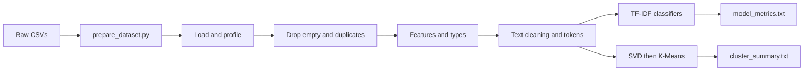

# YouTube Spam Collection — Analysis & Classification

**CSCI461 – Assignment #1**

Spam detection and unsupervised clustering on public YouTube comments from five popular music videos.

**Team**

1. Zeyad Ahmed
2. Mohamed Abdellatif
3. Steven Wilson
4. Abdalsalam Zaqzouq

---

## Overview

This project builds an end-to-end text analytics pipeline on the [YouTube Spam Collection](https://archive.ics.uci.edu/dataset/380/youtube+spam+collection):

1. Merge five labeled comment files into a single dataset with a `VIDEO` source column
2. Clean comments, engineer features, and compare spam vs. legitimate language
3. Train supervised TF-IDF classifiers to detect spam
4. Cluster comments with K-Means to uncover thematic structure

**Primary supervised result:** Logistic Regression with unigram TF-IDF reaches **94.6% accuracy** and **0.942 F1** on the spam class (stratified 80/20 test split). Five-fold cross-validation accuracy is **0.938 ± 0.016**.

**Clustering result:** K-Means with **k = 8** (silhouette **0.105**, adjusted Rand index **0.082**) groups comments more by theme and artist than by the spam label.

---

## Dataset

| Field        | Description                                                                          |
| ------------ | ------------------------------------------------------------------------------------ |
| `COMMENT_ID` | Unique comment identifier                                                            |
| `AUTHOR`     | Comment author display name                                                          |
| `DATE`       | Timestamp of the comment                                                             |
| `CONTENT`    | Raw comment text                                                                     |
| `CLASS`      | `1` = spam, `0` = not spam                                                           |
| `VIDEO`      | Source video (added by `prepare_dataset.py`): Psy, KatyPerry, LMFAO, Eminem, Shakira |

Raw CSVs live under `data/raw_data/`. Running `prepare_dataset.py` concatenates them and writes `data/dataset.csv` (1,953 rows before notebook cleaning; 1,753 after removing empty and duplicate comments).

**Citation:** Alberto, T. C., Lochter, J. V., & Almeida, T. A. (2015). _TubeSpam: Comment Spam Filtering on YouTube_. IEEE ICMLA. Dataset hosted on the [UCI Machine Learning Repository](https://archive.ics.uci.edu/dataset/380/youtube+spam+collection).

---

## Repository layout

```
Big_Data_assignment_1/
├── data/
│   ├── raw_data/              # Per-video YouTube Spam Collection CSVs
│   └── dataset.csv            # Merged dataset (+ VIDEO column)
├── notebook/
│   └── analysis.ipynb         # Full analysis: EDA, classification, clustering
├── output/
│   ├── cleaned_data.csv       # Cleaned features + cluster assignments
│   ├── model_metrics.txt      # Supervised metrics and interpretation
│   └── cluster_summary.txt    # K-Means silhouette, sizes, top terms
├── prepare_dataset.py         # Merge raw CSVs → dataset.csv
├── dockerfile                 # Jupyter SciPy image + NLTK
├── requirements.txt           # Extra pip deps (NLTK)
└── README.md
```

---

## How to run

### Docker (recommended)

The Dockerfile is based on `quay.io/jupyter/scipy-notebook` and installs NLTK from `requirements.txt`. It copies `data/dataset.csv` and `notebook/` into the container.

```bash
docker build -f dockerfile -t youtube-spam .
docker run --rm -p 8888:8888 youtube-spam
```

Open the printed Jupyter URL, launch `notebook/analysis.ipynb`, and **Run All**. Paths resolve relative to the project root (`SEED = 42` for reproducibility).

### Rebuild the merged dataset

If you change files under `data/raw_data/`:

```bash
python prepare_dataset.py
```

### Local Jupyter (optional)

The SciPy notebook image already provides pandas, NumPy, scikit-learn, matplotlib, seaborn, and Jupyter. Locally, install those plus NLTK, then open the notebook from the project root (or from `notebook/` — the notebook detects either layout):

```bash
pip install pandas numpy scikit-learn matplotlib seaborn nltk jupyter
jupyter notebook notebook/analysis.ipynb
```

---

## Analysis pipeline



1. **Load & profile** — Schema, class balance, and per-video counts
2. **Missing values & duplicates** — Drop comments with no text; keep the first exact duplicate of `CONTENT`
3. **Transformation & features** — `DATE` → datetime, `VIDEO` → category; character length, length bins, min-max scaling; URL, digit, exclamation, and uppercase-ratio features
4. **Sampling & correlation** — Simple, stratified, and cluster (by video) samples; numeric correlations
5. **Text cleaning** — HTML unescape, strip tags, normalize Unicode, map URLs → `url` and digits → `num`, tokenize with NLTK `RegexpTokenizer`
6. **Supervised classification** — Stratified 80/20 split; models compared:
   - Logistic Regression (unigrams) — **primary**
   - Multinomial Naive Bayes (unigrams)
   - Logistic Regression (unigrams + bigrams)
7. **K-Means clustering** — TF-IDF → TruncatedSVD (100 components) → L2 normalization; try **k = 2…8**; choose highest silhouette (**k = 8**)

---

## Results

### Supervised classification

| Model                             | Accuracy | Precision (spam) | Recall (spam) | F1 (spam) |
| --------------------------------- | -------- | ---------------- | ------------- | --------- |
| Logistic Regression (unigrams)    | 0.946    | 0.975            | 0.911         | 0.942     |
| Multinomial NB (unigrams)         | 0.926    | 0.933            | 0.911         | 0.922     |
| Logistic Regression (uni+bigrams) | 0.940    | 0.980            | 0.893         | 0.935     |

- 5-fold CV accuracy: **0.938 ± 0.016**
- 5-fold CV F1 (spam): **0.933 ± 0.018**
- Words associated with spam include _url_, _subscribe_, _check_, _channel_; words associated with legitimate comments include _song_, _views_, _love_, _best_

Full detail: [`output/model_metrics.txt`](output/model_metrics.txt).

### Clustering

- **k = 8**, silhouette **0.105**, ARI vs. spam labels **0.082**
- Some clusters are nearly pure spam (e.g. subscribe / URL / promo language); others reflect praise, artist names, or view-count talk

Full detail: [`output/cluster_summary.txt`](output/cluster_summary.txt).

### Limitations

- The collection covers only five music videos; performance may not transfer to other channels or newer spam styles
- TF-IDF is a bag-of-words model and ignores word order and context
- A random train/test split can place comments from the same videos in both sets, which can make scores optimistic
- Cleaning drops emojis and non-Latin text
- Low silhouette and ARI indicate clusters are thematic groupings, not a substitute for the spam classifier

---

## Outputs

| File                         | Description                                                           |
| ---------------------------- | --------------------------------------------------------------------- |
| `output/cleaned_data.csv`    | Cleaned comments, engineered features, and final cluster id           |
| `output/model_metrics.txt`   | Classification metrics, confusion matrix, CV scores, top coefficients |
| `output/cluster_summary.txt` | Silhouette / inertia by k, cluster sizes, top terms, label cross-tab  |
| `output/figures/`            | Plots created when the notebook is run (directory created at runtime) |

---
